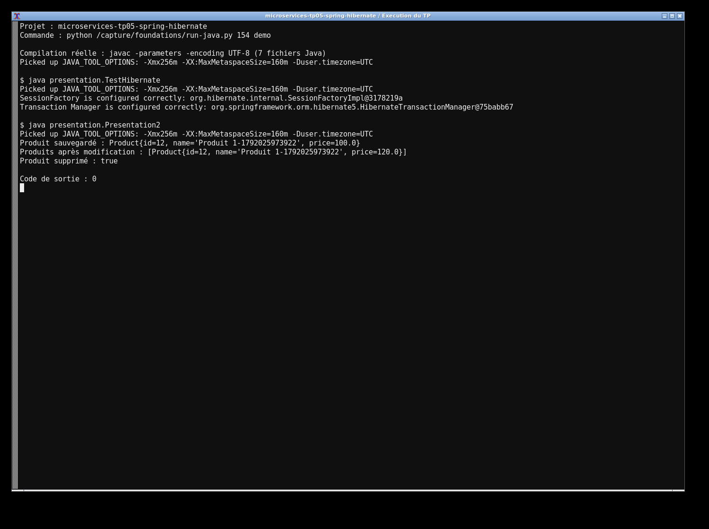
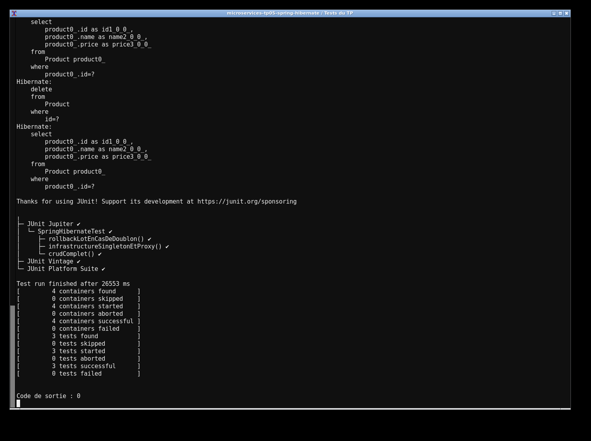

# TP5 — Intégration Spring et Hibernate

J'ai intégré Spring 5.3.22 et Hibernate 5.6.12 pour gérer les produits dans MySQL. `HibernateConfig` crée la source de données, la `SessionFactory` et le gestionnaire de transactions. `ProductDaoImpl` est un bean `@Repository` qui utilise les sessions courantes et les transactions Spring pour toutes les opérations CRUD.

J'utilise Java 17 et Maven. Pour lancer le projet :

```sh
docker compose up -d --wait
mvn clean test
mvn exec:java
mvn exec:java -Dexec.mainClass=presentation.TestHibernate
```

La base `base` écoute sur 13317 (`root` / `labroot`). Les variables `DB_URL`, `DB_USER` et `DB_PASSWORD` peuvent remplacer la configuration locale. La démonstration ajoute un produit, le lit, modifie son prix puis le supprime. Les tests passent par le vrai proxy Spring sur MySQL : ils vérifient aussi qu'un doublon dans un lot annule la transaction entière et qu'une nouvelle écriture fonctionne après le rollback.

Les captures montrent l'exécution réelle du projet et des tests sur ma machine.



